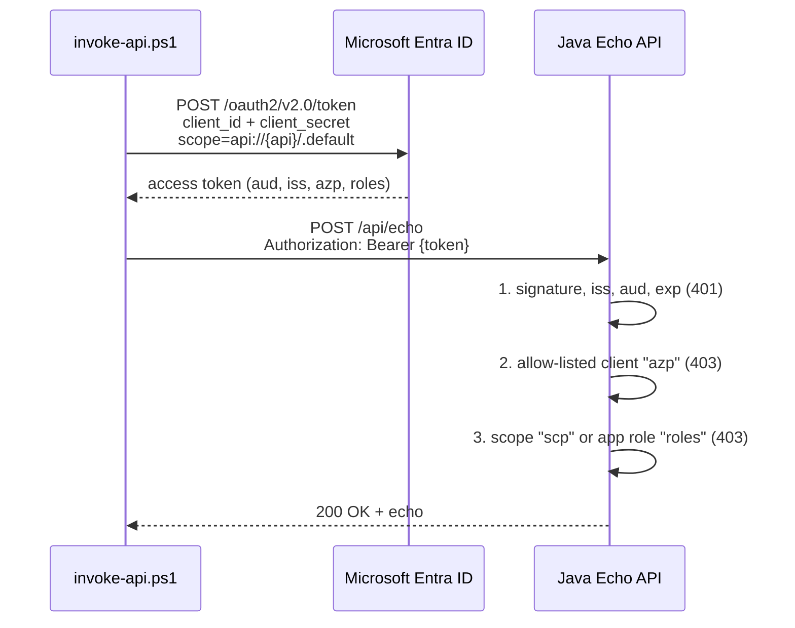

# REST API secured with Microsoft Entra ID (Java 8 / Maven)

Spring Boot REST API that is protected with Microsoft Entra ID access tokens.
It has a single endpoint `POST /api/echo` which echoes back the request body and
the details of the authenticated caller (claims and authorities from the access token).

Request is accepted only if **all** these validations pass:

| # | Validation | Implemented by | On failure |
|---|------------|----------------|------------|
| 1 | **Standard Entra ID token validation**: signature (tenant signing keys), issuer (exactly your tenant), audience (your API), lifetime (`exp`, `nbf`) | Spring Security `NimbusJwtDecoder` + `JwtValidators` + `JwtClaimValidator` with Entra ID endpoints from Spring Cloud Azure | `401 Unauthorized` |
| 2 | **Scope validation**: token must contain `Echo.ReadWrite` either as delegated permission (`scp` claim, user tokens) or as application permission (`roles` claim, app-only tokens) | Spring Cloud Azure claim mapping (`scp` → `SCOPE_`, `roles` → `APPROLE_`) + `@PreAuthorize` | `403 Forbidden` |
| 3 | **Allow-listed clients**: calling application (`azp` claim) must be in `ALLOWED_CLIENT_IDS` | Spring Cloud Azure claim mapping (`azp` → `CLIENT_`) + `hasAnyAuthority(...)` | `403 Forbidden` |

There is no custom security code: everything is configuration of
[Spring Cloud Azure](https://learn.microsoft.com/azure/developer/java/spring-framework/) (Microsoft SDK)
and standard [Spring Security OAuth 2.0 Resource Server](https://docs.spring.io/spring-security/reference/servlet/oauth2/resource-server/jwt.html) building blocks.
See [SecurityConfig.java](src/main/java/com/example/entraid/SecurityConfig.java),
[EchoController.java](src/main/java/com/example/entraid/EchoController.java) and
[application.yml](src/main/resources/application.yml).



## About Java versions

- **Java 1.8** = Java 8. Old naming scheme `1.x` was used up to Java 8; later versions are just `9`, `11`, `17`, `21`, `25`...
- **Maven** = Build tool which downloads dependencies (defined in [pom.xml](pom.xml)) and builds the application.

Java 8 limits which library versions can be used. This example uses the latest versions that still support Java 8:

| Library | Version | Note |
|---------|---------|------|
| Spring Boot | 2.7.18 | Last Spring Boot line supporting Java 8. Spring Boot 3.x requires Java 17. |
| Spring Cloud Azure (`spring-cloud-azure-starter-active-directory`) | 4.20.0 | Microsoft SDK line for Spring Boot 2.x. 5.x+ requires Spring Boot 3 / Java 17. |

> [!IMPORTANT]
> Java 8 and Spring Boot 2.7 open-source support have ended. It works, but you should
> plan to upgrade to Java 17+ and Spring Boot 3 (+ Spring Cloud Azure 5.x+).

### Can I build this with newer Java versions?

Yes. Newer JDK can create Java 8 compatible application. [pom.xml](pom.xml) has
`java.version=1.8` and on JDK 9+ it automatically uses `--release 8` which also verifies
that only Java 8 APIs are used. Tested with:

- JDK 25 + Maven 3.9 (local machine): builds Java 8 bytecode and runs
- Real Java 8 using Docker image `maven:3.9-eclipse-temurin-8` (build) and `eclipse-temurin:8-jre` (runtime): see [Dockerfile](Dockerfile)

So if you have *any* JDK + Maven installed, you don't need to install Java 8.
If you want to verify with real Java 8 runtime, use Docker.

## Files

| File | Description |
|------|-------------|
| [create-entra-id-apps.ps1](create-entra-id-apps.ps1) | Creates Entra ID app registrations using Azure CLI and writes `.env` file |
| [invoke-api.ps1](invoke-api.ps1) | Calls the API using only built-in PowerShell cmdlets (`Invoke-RestMethod`). Reads secrets from `.env` file |
| [delete-entra-id-apps.ps1](delete-entra-id-apps.ps1) | Deletes the app registrations listed in `.env` file |
| [.env.example](.env.example) | Example of `.env` file |
| [Dockerfile](Dockerfile) | Builds and runs the app on real Java 8 |

## 1. Setup Entra ID applications

You need [Azure CLI](https://learn.microsoft.com/cli/azure/install-azure-cli) and permissions to
create app registrations and grant admin consent (e.g., *Cloud Application Administrator*).

```powershell
az login
.\create-entra-id-apps.ps1
```

Script creates these app registrations and writes all the ids and secrets to `.env` file
(it's in `.gitignore`, never commit it):

| App registration | Purpose |
|------------------|---------|
| `Java Echo API` | The API. Application ID URI `api://{appId}`, access token version 2.0, exposes `Echo.ReadWrite` as **scope** (delegated, for users) and **app role** (application, for daemons/services). |
| `Java Echo Client` | Client application with client secret. Granted (admin consented) `Echo.ReadWrite` application permission. **Is** in the allow-list. |
| `Java Echo Client - Not Allow-listed` | Same as above but **not** in the allow-list. Used to demonstrate HTTP 403. |

Optional `-AllowAzureCli` switch pre-authorizes Azure CLI to request the `Echo.ReadWrite` scope
and adds it to the allow-list so that you can test delegated (user) tokens:

```powershell
.\create-entra-id-apps.ps1 -AllowAzureCli
```

### Manual setup in Azure Portal

If you can't use the script, these are the same steps in [Entra admin center](https://entra.microsoft.com) > *App registrations*:

1. **API app**: *New registration* > Name `Java Echo API`, *Single tenant* > *Register*.
   1. *Expose an API* > *Add* Application ID URI `api://{appId}`.
   2. *Expose an API* > *Add a scope* > `Echo.ReadWrite`, *Admins and users*.
   3. *App roles* > *Create app role* > Allowed member types *Applications*, value `Echo.ReadWrite`.
   4. *Manifest* > set `"requestedAccessTokenVersion": 2` (v2.0 tokens contain `azp` claim used for the allow-list).
2. **Client app**: *New registration* > Name `Java Echo Client` > *Register*.
   1. *Certificates & secrets* > *New client secret*.
   2. *API permissions* > *Add a permission* > *My APIs* > `Java Echo API` > *Application permissions* > `Echo.ReadWrite`.
   3. *Grant admin consent*.
3. Fill in `.env` using [.env.example](.env.example) as template.
   Add client app's *Application (client) ID* to `ALLOWED_CLIENT_IDS`.

## 2. Run the API

The application reads configuration from `.env` file (`spring.config.import=optional:file:.env[.properties]`)
or from environment variables:

| Variable | Description |
|----------|-------------|
| `TENANT_ID` | Entra ID tenant id |
| `API_CLIENT_ID` | API app registration client id (valid audience) |
| `API_APP_ID_URI` | API Application ID URI, e.g., `api://{API_CLIENT_ID}` (valid audience) |
| `ALLOWED_CLIENT_IDS` | Comma separated list of client application ids allowed to call the API. Empty = deny all |

**Option A: Local JDK (any version 8+) and Maven**

```powershell
mvn package
java -jar target\entra-id-secured-api-1.0.0.jar
```

**Option B: Docker with real Java 8** (nothing else needs to be installed)

```powershell
docker build -t entra-id-secured-api .
docker run --rm -p 8080:8080 --env-file .env entra-id-secured-api
```

## 3. Call the API

```powershell
.\invoke-api.ps1
```

Script acquires access tokens using the
[OAuth 2.0 client credentials flow](https://learn.microsoft.com/entra/identity-platform/v2-oauth2-client-creds-grant-flow)
and calls the API three times:

```text
=== 1) No access token (expected HTTP 401) ===
HTTP 401

=== 2) Allow-listed client (expected HTTP 200) ===
{
  "message": "Hello from Java 1.8.0_504",
  "name": "44444444-4444-4444-4444-444444444444",
  "authorities": [
    "APPROLE_Echo.ReadWrite",
    "CLIENT_33333333-3333-3333-3333-333333333333"
  ],
  "claims": {
    "aud": [ "22222222-2222-2222-2222-222222222222" ],
    "iss": "https://login.microsoftonline.com/11111111-1111-1111-1111-111111111111/v2.0",
    "azp": "33333333-3333-3333-3333-333333333333",
    "roles": [ "Echo.ReadWrite" ],
    "ver": "2.0",
    ...
  },
  "request": {
    "message": "Hello from PowerShell",
    "timestamp": "2026-10-30T09:32:46.4914768+02:00"
  }
}
HTTP 200

=== 3) Not allow-listed client (expected HTTP 403) ===
HTTP 403
```

### Delegated (user) token using Azure CLI

If you used `-AllowAzureCli` switch, you can call the API as yourself.
Then the token has `scp` claim instead of `roles`:

```powershell
$apiAppIdUri = "api://<API_CLIENT_ID>"
$token = az account get-access-token --scope "$apiAppIdUri/Echo.ReadWrite" --query accessToken -o tsv
Invoke-RestMethod -Method Post -Uri http://localhost:8080/api/echo `
  -Headers @{ Authorization = "Bearer $token" } `
  -ContentType "application/json" -Body '{"hello":"user"}'
# authorities: SCOPE_Echo.ReadWrite, CLIENT_04b07795-8ddb-461a-bbee-02f9e1bf7b46 (Azure CLI)
```

## Tests

[EntraIdSecuredApiTests.java](src/test/java/com/example/entraid/EntraIdSecuredApiTests.java) covers
all validation layers (401 no/invalid token, 403 missing scope, 403 not allow-listed client,
200 for user and app tokens, rejected issuer from other tenant, wrong audience and expired token):

```powershell
mvn test
```

## Notes

- Why not use Spring Cloud Azure's default `JwtDecoder`? In 4.x it accepts *any* Entra ID tenant as issuer
  (`https://login.microsoftonline.com/` prefix). This example pins the issuer to your own tenant using
  standard Spring Security `JwtValidators.createDefaultWithIssuer(...)`.
- `ALLOWED_CLIENT_IDS` uses the `azp` claim which exists in **v2.0** access tokens.
  That's why API app has `requestedAccessTokenVersion` set to `2`.
  (v1.0 tokens have the same information in `appid` claim.)
- CSRF protection is disabled and sessions are stateless because this is a bearer token API (no cookies).
- Log message `The following Netty versions were found on the classpath and have a mismatch...` can be ignored.
  Spring Boot 2.7 manages older Netty version than Azure SDK prefers, but Azure SDK HTTP client isn't
  used here (signing keys are fetched by Spring Security).

## Cleanup

```powershell
.\delete-entra-id-apps.ps1
```

## Links

[Spring Cloud Azure: Protect a REST API with Microsoft Entra ID (resource server)](https://learn.microsoft.com/azure/developer/java/spring-framework/spring-security-support?tabs=SpringCloudAzure4x)

[Spring Cloud Azure 4.x support for Spring Security](https://learn.microsoft.com/azure/developer/java/spring-framework/configuration-properties-azure-active-directory)

[Microsoft identity platform access tokens](https://learn.microsoft.com/entra/identity-platform/access-tokens)

[Access token claims reference (`azp`, `scp`, `roles`)](https://learn.microsoft.com/entra/identity-platform/access-token-claims-reference)

[Protected web API: Verify scopes and app roles](https://learn.microsoft.com/entra/identity-platform/scenario-protected-web-api-verification-scope-app-roles)

[Spring Boot support for Java versions](https://spring.io/projects/spring-boot#support)
